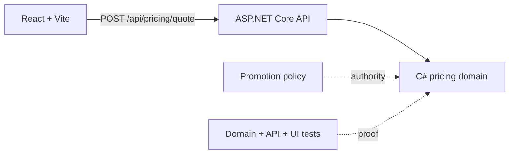

# From “Copilot Is Dumb” to a Reliable Agent

A 30-minute, hands-on GitHub Copilot workshop about context engineering.

## Observable outcome

Participants will turn an ambiguous “fix the bug” request into a context packet that identifies the target, authoritative contract, constraints, executable acceptance criteria, excluded stale evidence, and verification commands.

## Scenario

A real full-stack e-commerce slice—C# pricing domain, ASP.NET Core API, and React/Vite client—looks plausible but violates three business rules:

- the SAVE20 discount is capped at EUR 50;
- it cannot stack with a category discount;
- final currency values use two-decimal, away-from-zero rounding.

The repository also contains stale notes describing rejected behavior. The demo first gives Copilot a weak prompt, then provides engineered context and durable repository instructions. The browser makes the broken contract visible while domain specs, API integration tests, and React tests provide a verification ladder.



## Requirements

- .NET SDK 10
- Node.js 24+
- Git
- VS Code with GitHub Copilot Chat, or another Copilot surface that can edit the workspace
- PowerShell on Windows or Bash/Git Bash

## Start in the intentional red state

```powershell
cd demo
./scripts/Reset-Demo.ps1
./scripts/Verify-Baseline.ps1
```

Bash/Git Bash:

```bash
cd demo
./scripts/reset-demo.sh
./scripts/verify-baseline.sh
```

Expected: three failed pricing specifications.

## Live comparison

### Weak request

Paste `demo/prompts/weak-prompt.txt` into a **fresh** Copilot chat:

```text
Fix the discount bug in `PricingCalculator.cs`.
```

The task gives no authority, no cap rule, no stacking rule, no rounding rule, and no verification contract. Treat the response as a diagnosis of the prompt—not a contest to make the model fail in one exact way.

### Engineered request

1. Apply durable context:

```powershell
./scripts/Apply-Context.ps1
```

2. Open a fresh Copilot chat.
3. Attach or open:
   - `src/Commerce.Pricing/PricingCalculator.cs`
   - `tests/Commerce.Pricing.Specs/Program.cs`
   - `docs/promotion-policy.md`
4. Paste `prompts/engineered-prompt.txt`.
5. Review the proposed diff before accepting.
6. Run the verification ladder.

## Deterministic fallback

If Copilot diverges or network access fails:

```powershell
./scripts/Apply-KnownFix.ps1
./scripts/Verify-Fixed.ps1
```

Bash:

```bash
./scripts/apply-known-fix.sh
./scripts/verify-fixed.sh
```

Expected:

```text
PASS: 5 pricing specifications
Passed! - Commerce.Api.Tests
Test Files  2 passed (2)
VERIFIED GREEN: domain specs, API tests, React tests, production builds, and change scope pass.
```

## Run the full-stack app

From `demo`, use two terminals:

```bash
dotnet run --project src/Commerce.Api --urls http://localhost:5055
```

```bash
npm ci --prefix web
npm run dev --prefix web
```

Open the Vite URL (normally `http://localhost:5173`). See [`demo/README.md`](demo/README.md) for the architecture, test matrix, and Copilot customization examples.

## Reset for the next presentation

```powershell
./scripts/Reset-Demo.ps1
./scripts/Verify-Baseline.ps1
```

## Workshop files

- `Workshop-Script-Practical-30-Min.md` — verbatim presenter script
- `Practical-Demo-Runbook.md` — click-by-click demo and recovery
- `Participant-Worksheet.md` — exercise and answer key
- `Context-Card.md` — the reusable context packet
- `demo/` — runnable C# + ASP.NET Core + React/Vite example

## Key lesson

Apparent agent “intelligence” is often a property of the context system around the model. Better context is not more text. It is selected, authoritative, scoped, and verifiable evidence.

## References

- GitHub Copilot customization cheat sheet: https://docs.github.com/en/copilot/reference/customization-cheat-sheet
- Custom instructions: https://docs.github.com/en/copilot/concepts/prompting-and-context/custom-instructions
- Prompt files: https://docs.github.com/en/copilot/concepts/prompting-and-context/prompt-files
- Agent skills: https://docs.github.com/en/copilot/concepts/agents/about-agent-skills
