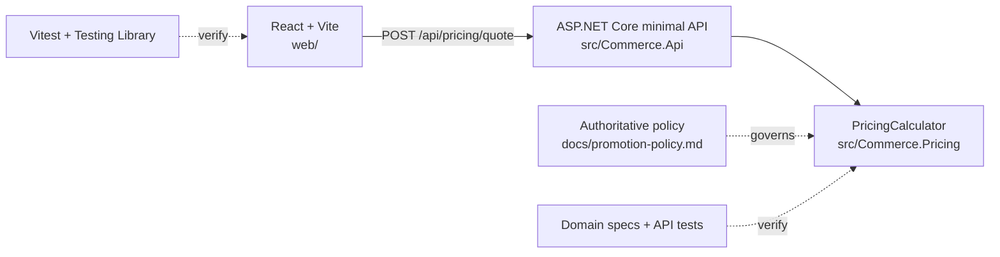

# Full-stack demo: C# API + React/Vite

This is a runnable e-commerce pricing slice, not a toy function in isolation. The browser sends basket context to an ASP.NET Core API, which delegates the business decision to the C# pricing domain.



## Why this structure matters for Copilot

| Artifact | Role in the context packet | Authority? |
|---|---|---:|
| `docs/promotion-policy.md` | Business contract | Yes |
| `src/Commerce.Pricing/PricingCalculator.cs` | Change target | No |
| `tests/Commerce.Pricing.Specs` | Fast executable acceptance criteria | No |
| `tests/Commerce.Api.Tests` | HTTP-boundary acceptance criteria | No |
| `src/Commerce.Api` | Delivery adapter and scope boundary | No |
| `web` | Real consumer and visible feedback | No |
| `docs/stale-promotion-notes.md` | Rejected historical evidence | Explicitly exclude |

The pricing rule stays in one place. The API does validation and transport mapping. React displays the API result and never becomes a second pricing engine.

## Run the application

Requirements: .NET SDK 10 and Node.js 24 or newer.

Terminal 1, from `demo`:

```bash
dotnet run --project src/Commerce.Api --urls http://localhost:5055
```

Terminal 2:

```bash
npm ci --prefix web
npm run dev --prefix web
```

Open the Vite URL (normally `http://localhost:5173`). The Vite proxy forwards `/api` requests to the C# API.

Try these baskets before and after the workshop fix:

| Subtotal | Code | Category discount? | Contract result |
|---:|---|---:|---:|
| €100.00 | SAVE20 | No | €80.00 |
| €400.00 | SAVE20 | No | €350.00 (cap) |
| €100.00 | SAVE20 | Yes | €100.00 (no stacking) |
| €99.99 | SAVE20 | No | €79.99 (away-from-zero rounding) |

The repository intentionally starts with the last three rules broken. That is the workshop's reproducible red state.

## Run the workshop loop

Bash/Git Bash:

```bash
./scripts/reset-demo.sh
./scripts/verify-baseline.sh       # expected red
./scripts/apply-context.sh         # installs Copilot context locally
# Ask Copilot to solve prompts/engineered-prompt.txt
./scripts/apply-known-fix.sh       # deterministic fallback
./scripts/verify-fixed.sh          # six-step green verification
./scripts/reset-demo.sh            # restore workshop state
```

PowerShell users can run the equivalent `.ps1` scripts.

## Verification ladder

From `demo`:

```bash
dotnet run --project tests/Commerce.Pricing.Specs
dotnet test tests/Commerce.Api.Tests
npm test --prefix web
dotnet build CommercePricing.slnx --nologo
npm run build --prefix web
git diff --name-only
```

`verify-fixed` runs this ladder after installing locked frontend dependencies. CI proves both states: the known baseline fails for the expected reason, then the known fix passes every layer.

## Copilot best-practice examples

Run `scripts/apply-context` to install the versioned examples from `context-kit/.github` into the demo workspace:

- `copilot-instructions.md` — stable repository architecture, authority, and commands;
- `instructions/pricing.instructions.md` — C# money and domain rules, scoped to pricing files;
- `instructions/react.instructions.md` — React boundaries, accessibility, and test rules, scoped to the client;
- `prompts/fix-pricing.prompt.md` — one task with target, authority, exclusions, constraints, acceptance criteria, and verification.

The generated `demo/.github` directory is ignored so every workshop starts clean. The source templates under `context-kit` are committed and reviewable.
